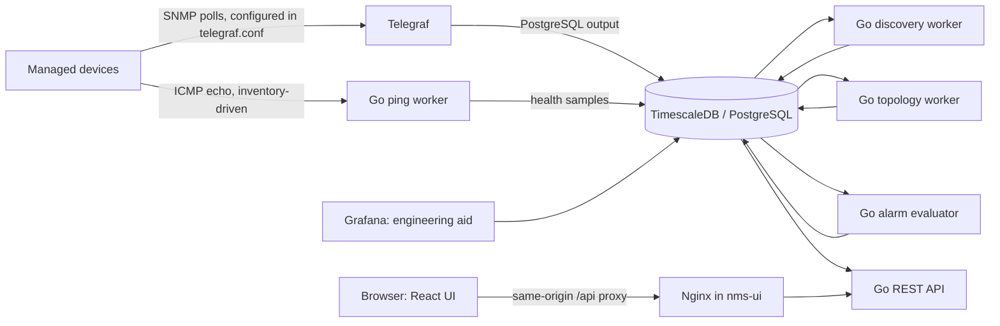

# NMS architecture: current implementation

This document explains the behavior in the checked-in code and Compose files.
It is a guide for reading and changing the system, not a claim that every
feature required for a production NMS is complete. For the actual local startup
procedure, see [running.md](running.md). For the real-network pilot checklist,
see [real-world-deployment.md](real-world-deployment.md).

## 1. System at a glance

Telegraf currently owns the SNMP target list and credentials in
[`../telegraf.conf`](../telegraf.conf); adding an inventory record does not add
it to Telegraf. The Go process reads the inventory for its ICMP sweep and alarm
evaluation. Both processes write to the same database. The React application
uses the Go API through Nginx. Grafana is present as an engineering aid; the
operator application is the React UI.

## 2. Compose services and network boundaries

The authoritative configuration is [`../docker-compose.yml`](../docker-compose.yml).

| Service | Role | Network attachment / exposure |
|---|---|---|
| `timescaledb` | PostgreSQL 15 with TimescaleDB, persistent database volume | `data_net` (`internal: true`); port 5432 is not published to the host |
| `telegraf` | Polls static ICMP and SNMP targets; inserts metrics | `nms_net` and `data_net` |
| `nms-middleware` | Go API, ICMP worker, discovery, topology, and alarm workers | `nms_net`, `data_net`, `app_net`; container port 8080 is exposed internally, not host-published |
| `nms-ui` | Static React build served by Nginx; proxies `/api/` to Go | `app_net`; host bind defaults to `127.0.0.1:3000` |
| `mock-*` | Simulated SNMP/ICMP agents for the demo lab | Static addresses on `nms_net` |
| `grafana` | Optional engineering dashboards | `data_net`; host bind defaults to loopback port 3001 |

The Compose DB and Telegraf image tags use `latest` tags today. The middleware
and UI containers use read-only filesystems, drop Linux capabilities, and set
`no-new-privileges`; those container controls do not replace network policy,
TLS, secrets management, backups, or host hardening. `DB_PASSWORD` and
`NMS_BOOTSTRAP_TOKEN` are supplied from `.env`; the DB DSN currently sets
`sslmode=disable`, which is suitable only for the private Compose network unless
the deployment changes the database transport design.

Browser request path:

1. The browser loads the static UI from `nms-ui` at port 3000.
2. The UI calls relative `/api/...` URLs, with same-origin cookies.
3. Nginx forwards `/api/session` and `/api/` to `nms-middleware:8080` on
   `app_net`.
4. Middleware queries or mutates PostgreSQL over `data_net`.

The backend listens on `:8080` because other containers need to reach it. The
Compose file does not publish that port to the host.

## 3. Startup sequence and ownership

Read [`../main.go`](../main.go) top to bottom to follow process startup:

1. Parse `-db-dsn` and `-env`; `NMS_DB_DSN` provides the default DSN. The
   production flag selects JSON logging; otherwise logs are text.
2. Create an in-memory session store. Startup fails unless
   `NMS_BOOTSTRAP_TOKEN` has at least 32 characters.
3. Open and ping a `pgxpool` (maximum 25, minimum 5 connections).
4. Install the audit recorder, create a signal-cancelled root context, then
   run `db.RunMigrations` before launching engines.
5. Start ICMP sweeps every 15 seconds, topology sync every 30 seconds, device
   discovery every minute, and five alarm workers with a 30-second evaluation
   tick.
6. Register HTTP routes and start the API on `:8080`.
7. On SIGINT/SIGTERM, stop the HTTP listener gracefully (up to 10 seconds) and
   close the DB pool. Worker loops observe the root context.

`migration.sql` initializes a fresh DB through the PostgreSQL image's
entrypoint. `db.RunMigrations` runs on every middleware start as an additional,
application-owned schema synchronization pass. It is separate from the SQL
file: for existing DBs, it patches a selected set of tables/columns and seeds
`device_models`; it is not a general migration-version framework. Read both
[`../migration.sql`](../migration.sql) and [`../db/db.go`](../db/db.go) before
changing schema behavior.

## 4. Telemetry pipeline

### SNMP and Telegraf

[`../telegraf.conf`](../telegraf.conf) has four input tracks:

| Track | Current collection | Destination / consumer |
|---|---|---|
| ICMP | `inputs.ping` against hard-coded `192.168.10.x` addresses, every 15 seconds, two probes | Telegraf PostgreSQL output table `device_health_metrics` (raw plugin fields) |
| Device health | SNMPv2, 30-second agent interval, UCD-style CPU and memory OIDs | `snmp_device_health`; dashboard, memory alarm, SNMP freshness alarm |
| Interfaces | IF-MIB interface table: admin/oper, speed/high speed, HC and legacy counters, errors/discards | `interface_performance_metrics`; device detail currently reads these raw rows |
| LLDP | LLDP remote-system table every 60 seconds | `snmp_lldp_topology`; Go topology worker |

The PostgreSQL output flush interval is 10 seconds. The config uses the
community `public` and SNMP version 2 for the demo targets. These are sample
values, not suitable production credentials. The currently configured vendor
CPU/memory OIDs must be validated against each real device family; their numeric
OIDs and output units are visible directly in the config.

Telegraf emits raw SNMP interface samples into `interface_performance_metrics`
with `agent_host`, `ifIndex`, `ifDescr`, and mixed-case SNMP field names. That
table also has normalized columns such as `interface_id`, `rx_bytes_delta`,
and `if_oper_status`, but Telegraf does not populate those normalized columns.
Quoted identifiers matter: SQL must spell fields such as `"ifIndex"` with the
same case.

### Go ICMP worker

[`../ping/pinger.go`](../ping/pinger.go) queries monitored `devices`, launches
one goroutine per device, sends an ICMP echo with a two-second socket deadline,
and inserts `icmp_status`, `icmp_rtt_ms`, and `icmp_packet_loss` into
`device_health_metrics`. It performs a sweep immediately on startup and then
each configured interval (15 seconds in `main.go`). The worker creates an ICMP
socket for each target. It does not use Telegraf's static `inputs.ping` list.

### Discovery worker

[`../discovery/discovery.go`](../discovery/discovery.go) checks recent
`snmp_interface.agent_host` values once a minute. If an IP is missing from
`devices`, it inserts a generic record named `discovered-<ip>` with type
`unknown_discovered`, SNMPv2c, community `public`, and monitoring enabled. It
does not identify the real vendor/model, populate interfaces, or add the host
to Telegraf's target list. Because it uses the raw telemetry table, a successful
Telegraf poll must already have happened before it can discover the address.

### Topology worker

[`../topology/topology.go`](../topology/topology.go) queries LLDP rows no older
than five minutes, resolves local and remote names against `devices`, and
upserts visible edges into `network_topology`. It derives the local port from
the LLDP local port field or the second component of the Telegraf row index.
Unresolved neighbors are skipped. Edges not refreshed in five minutes are
deleted; `network_topology` is therefore a current graph, not a topology event
history. Devices need LLDP enabled and readable with the configured SNMP
credentials.

## 5. Database model and data ownership

The exact starting schema is [`../migration.sql`](../migration.sql); Telegraf
may create/extend output tables depending on its version and metric fields.

| Table | Intended role | Current writer / consumer notes |
|---|---|---|
| `devices` | Inventory: address, hostname, type, location, SNMP settings, monitored flag | Migration seed, API CRUD, discovery; ICMP and alarm workers read it |
| `device_models` | Model catalog used to validate device CRUD | Seeded by `db.RunMigrations`; read by catalog API and device form |
| `interfaces` | Canonical relational interface records linked to a device | Schema exists; current discovery does not populate it automatically |
| `device_health_metrics` (hypertable) | ICMP results and schema fields for health telemetry | Go ping writes device-linked ICMP rows; Telegraf ping may write plugin rows with different fields; dashboard queries device-linked rows |
| `interface_performance_metrics` (hypertable) | Raw IF-MIB rows plus reserved normalized columns | Telegraf writes raw SNMP fields. Device detail derives bps/utilization from the latest two samples by `agent_host` + `ifIndex` |
| `snmp_device_health` (hypertable) | Raw CPU/memory samples | Telegraf writes; dashboard/detail and alarms read |
| `snmp`, `snmp_interface`, `snmp_lldp_topology` (hypertables) | Generic system, interface, and LLDP raw telemetry | Telegraf writes; discovery reads `snmp_interface`, topology reads LLDP table. The active IF-MIB table is named `interface_performance_metrics` rather than `snmp_interface` |
| `network_topology` | Current LLDP edge list | Topology worker writes; dashboard API reads |
| `network_events` (hypertable) | Alarm instances with event type, severity, resolved state and timestamp | Alarm strategies insert/auto-resolve; operator API can manually resolve |
| `audit_events` | Request metadata for authentication and protected API activity | Session/auth middleware and `AuditActivity`; bounded read API |

Database notes for implementation:

- Timescale hypertables are partitioned by `time`; indexes are defined in
  `migration.sql` for common device/interface/time lookups.
- The schema includes some nullable normalized columns for future or alternate
  writers. Their presence does not prove a writer currently fills them.
- The alarm worker's link and admin/oper mismatch strategies join
  `interface_performance_metrics.interface_id` to `interfaces.id`. Telegraf's
  current raw interface rows do not fill `interface_id`, and the current
  discovery code does not populate `interfaces`. Therefore these two alarm
  strategies require that normalized relationship to be populated by another
  path before they can evaluate those raw Telegraf rows.
- `device_health_metrics` also receives Telegraf ping plugin metrics. Confirm
  which columns are populated by the deployed Telegraf/PostgreSQL output version
  before relying on those rows; the Go worker is the explicit writer for the
  device-linked ICMP columns used by device-down evaluation.
- The high-CPU alarm reads `device_health_metrics.cpu_utilization`. The current
  Telegraf health track writes `cpu_idle`/`cpu_load_1` to
  `snmp_device_health`, and the Go ping worker does not write CPU data. Unless
  another writer fills `cpu_utilization`, the configured high-CPU strategy has
  no CPU input to evaluate.
- Seed rows in `migration.sql` are demo inventory. A real deployment must
  review/remove demo records and confirm schema behavior before using an
  existing database.
- There is a fresh-schema identifier mismatch to resolve: `migration.sql`
  declares `network_events` without an `id` column, but the device detail and
  manual-resolve handlers select/update events by `id`. The runtime repair in
  `db/db.go` adds `resolved_at`, not `id`. Existing databases may differ due to
  older schema history; confirm/fix this before relying on alarm detail or
  manual resolution after a clean database initialization.

## 6. Alarm evaluation

[`../alert/evaluator.go`](../alert/evaluator.go) runs a 30-second producer tick,
loads all monitored device IDs, and sends jobs to a buffered queue serviced by
five workers. Each worker invokes every strategy for its device. Strategies
and thresholds are registered in `main.go` and implemented in
[`../alert/strategiesImpl.go`](../alert/strategiesImpl.go).

| Alarm ID | Check performed in current code | Current severity / recovery behavior |
|---|---|---|
| 1 | ICMP samples from the previous minute; alarm if all available statuses are down; silence suppresses alarm | Critical; clears when at least one sample succeeds |
| 2 | Latest recent normalized interface status; `ifOperStatus=2` unless administratively down | Warning; clears when oper status returns up |
| 3 | Average `device_health_metrics.cpu_utilization` over two minutes exceeds 85% | Critical; clears at 80% or lower |
| 4 | Admin up + oper down in normalized interface rows | Warning; clears when both are up |
| 5 | Average memory utilization computed from `snmp_device_health` over two minutes | Warning at 80%, critical at 95%; clears at 75% or lower |
| 6 | No recent matching SNMP health/interface samples within five minutes | Critical; clears when fresh SNMP data returns |

The same event is generally suppressed through a query for an already-open
device/alarm pair. The database does not enforce a unique active alarm
fingerprint. Alarm ID 2/4 need the normalized interface join described above.
`DeviceDownStrategy` stores a `windowDuration` constructor argument, but its
query currently uses a literal one-minute interval; changing that constructor
argument does not change the query window.
There are no email, SMS, or webhook notifications in this path: events are
stored and displayed through the UI/API. The 19-item client alarm list is not
fully implemented by these six strategies.

## 7. HTTP API, authentication, and audit

Routes are registered in [`../main.go`](../main.go); handlers are in
[`../handlers`](../handlers). The UI API wrapper is
[`../ui/src/api.ts`](../ui/src/api.ts).

| Method and path | Authentication | Handler behavior |
|---|---|---|
| `GET /healthz` | None | Liveness response, HTTP 204 |
| `POST /api/session` | Bootstrap token | Checks same-origin, exchanges token for session cookie and CSRF token |
| `GET /api/session` | Session cookie | Returns current CSRF token/session status |
| `DELETE /api/session` | Session + CSRF | Ends session |
| `GET /api/v1/dashboard` | Session | Dashboard aggregates, events, recent series and topology |
| `GET /api/v1/device-models` | Session | Supported model catalog |
| `GET /api/v1/devices` | Session | Inventory; `page`, `page_size`, `q`, `type`, `status`, `monitored` query parameters |
| `GET /api/v1/devices/{id}` | Session | Device identity, latest health, alarms, interface counters and derived live rates |
| `POST /api/devices` | Session + CSRF | Create inventory record |
| `PUT /api/devices/{id}` | Session + CSRF | Edit inventory record |
| `DELETE /api/devices/{id}` | Session + CSRF | Delete inventory record and matching topology edges |
| `POST /api/v1/alarms/{id}/resolve` | Session + CSRF | Manually resolve event row |
| `GET /api/v1/audit` | Session | Newest-first paginated audit metadata |

`handlers/security.go` holds sessions in process memory for eight hours. Login
uses a shared bootstrap token and assigns the actor `bootstrap-admin`; restarting
the middleware invalidates sessions. This is single shared-operator identity,
not per-user SSO or role-based access control. Cookies are HttpOnly and
SameSite=Strict; HTTPS requests use a `__Host-` cookie with Secure. Mutating
requests require same-origin and a CSRF token. Nginx adds browser security
headers and rate limits login/API requests.

Audit records contain actor, action, outcome, HTTP method/path, status code and
time. They intentionally omit request bodies and query strings. The recorder is
best effort: a failed audit insert is logged, but does not roll back the API
operation. It is activity logging, not a tamper-proof compliance ledger.

## 8. UI request and view flow

The React application is under [`../ui/src`](../ui/src). `api.ts` is the typed
fetch wrapper and owns the in-memory CSRF token. `App.tsx` manages the views,
authentication state, detail panels and refresh timer. Once authenticated, the
main dashboard data is refreshed every 15 seconds. Nginx serves the built UI
and proxies `/api/` to the middleware. Grafana is separate and is not used by
the React application for its data.

To trace a user-visible field end-to-end, follow this chain:

1. UI view and TypeScript type in `ui/src/App.tsx` and `ui/src/api.ts`.
2. Endpoint registration and middleware wrapper in `main.go`.
3. Handler query and response struct in `handlers/*.go`.
4. Writer/query source in `ping/`, `discovery/`, `topology/`, `alert/`, or
   `telegraf.conf`.
5. Columns/indexes in `migration.sql` and any runtime repair in `db/db.go`.

## 9. Repository map for manual coding

| Path | Read/change it when working on… |
|---|---|
| `main.go` | Process startup, worker intervals, alarm registration, HTTP route table, shutdown |
| `db/db.go` | DB pool, runtime schema synchronization, model catalog seed, DB helper methods |
| `migration.sql` | Fresh database schema, indexes, seed data, hypertable declarations |
| `telegraf.conf` | SNMP/ICMP targets, OIDs, polling intervals, Telegraf database output |
| `ping/pinger.go` | Inventory-driven ICMP, result persistence |
| `discovery/discovery.go` | Automatic insertion of unregistered SNMP reporting IPs |
| `topology/topology.go` | LLDP row parsing, neighbor resolution, graph edge expiry |
| `alert/` | Alarm strategy interface, query, threshold, severity and recovery logic |
| `handlers/` | HTTP API, SQL aggregation, request validation, audit/security behavior |
| `ui/src/api.ts` | Endpoint calls, browser session/CSRF handling and API response types |
| `ui/src/App.tsx` | React views, forms, state, refresh and navigation |
| `ui/nginx.conf` | Static serving, API reverse proxy, UI response headers and rate limits |
| `docker-compose.yml` | Services, networks, volumes, ports and container security settings |
| `docs/real-world-deployment.md` | Real-device pilot, adaptation checklist and operational constraints |

### Typical coding sequence: add a device metric

1. Verify its device MIB/OID, value type, unit, access and polling cost.
2. Add/configure the Telegraf field or table in `telegraf.conf`.
3. Decide whether the data remains raw, or needs a normalized destination and
   an explicit writer/mapping step. Do not assume a matching column is written.
4. Update `migration.sql` and `db/db.go` only if a durable schema change is
   needed; handle both fresh and existing databases.
5. Add query/response logic in the relevant handler or alarm strategy.
6. Add/update TypeScript types and UI rendering.
7. Update this document and `PROJECT_STATUS.md` to state exactly what is
   implemented and what still needs device validation.

### Typical coding sequence: add an alarm

1. Define input data, device/resource identity, data freshness rules, and what
   should happen when telemetry is missing.
2. Implement an `AlarmStrategy` in `alert/`, including duplicate suppression,
   recovery, and severity.
3. Register it in `main.go`; assign a stable alarm ID/event type and update the
   catalog documentation.
4. Confirm that its input fields are actually populated by the deployed writer.
5. Confirm the event is returned by the dashboard/detail API and displayed by
   the UI. Notification delivery is a separate feature.

## 10. What this implementation does not currently provide

- Dynamic/inventory-driven Telegraf target configuration or per-device
  credential profiles.
- Automatic canonical interface inventory population and normalization of the
  raw Telegraf IF-MIB rows used by the two interface-state strategies.
- The full client alarm list, traps, syslog, email/SMS/webhook delivery, or
  configuration changes pushed to routers/switches.
- Per-user identity, SSO, granular roles, audit retention controls, or a
  tamper-evident audit store.
- A tested scale envelope, HA deployment, backup/restore procedure, retention
  policy, or vendor-by-vendor validation. These require deployment design and
  a representative real-device pilot.

Treat the default Compose stack as a development/demo environment until its
static targets, credentials, OIDs, routing, TLS, persistence, backup, and
monitoring are adapted and verified for the customer network.
